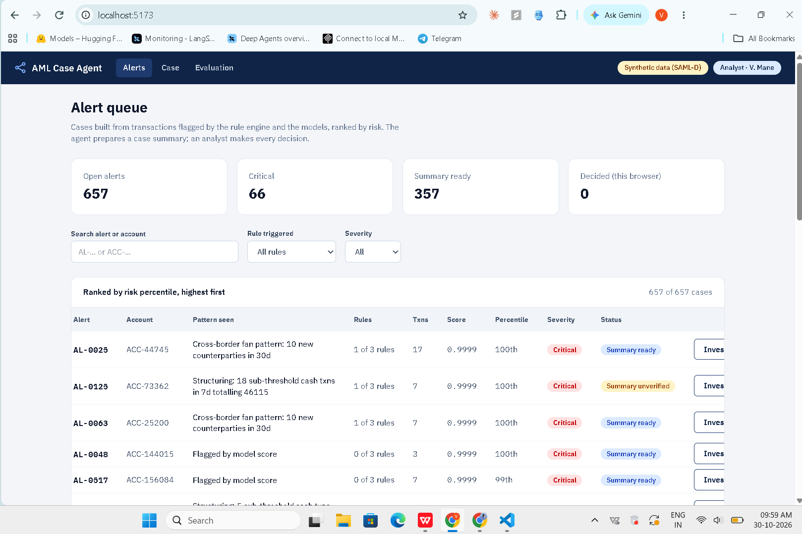
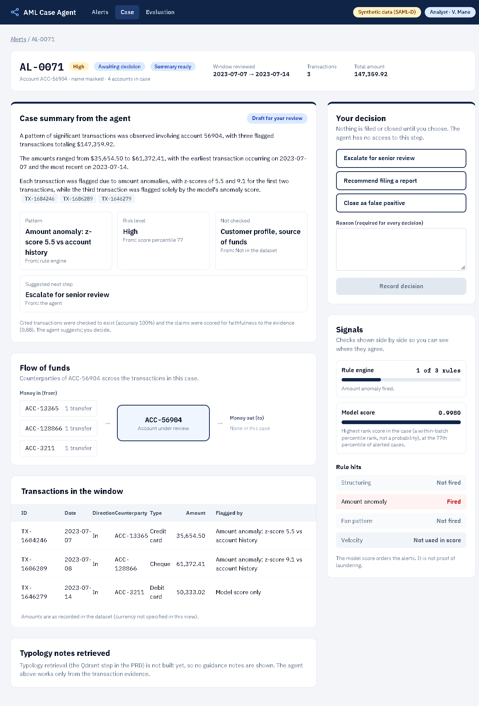
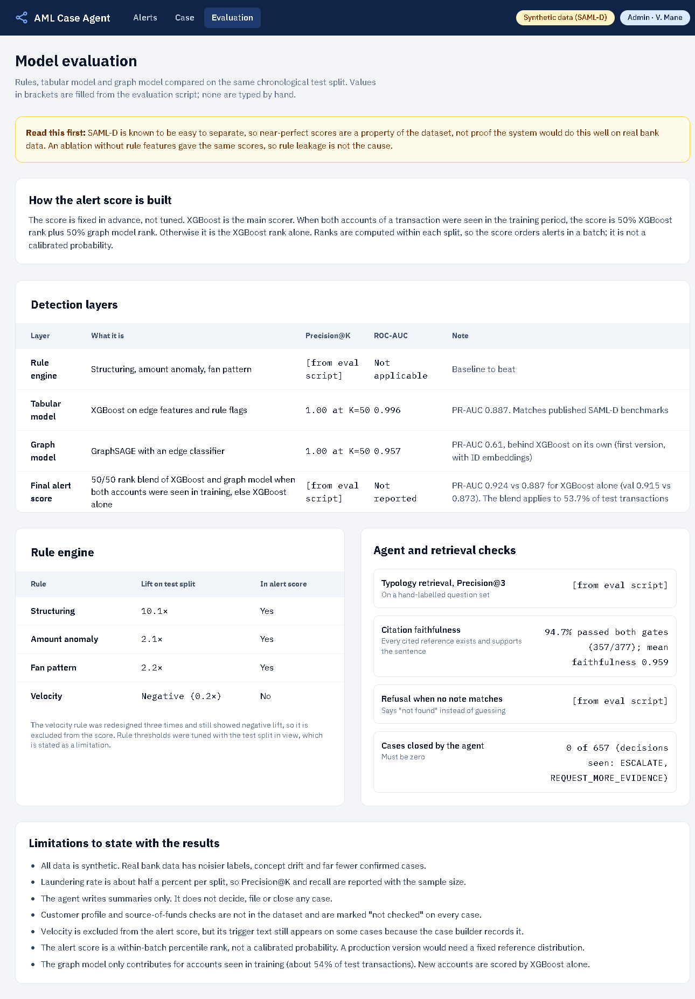

# AML Transaction Monitoring & Case Investigation Agent


An end-to-end anti-money-laundering prototype: detect suspicious transactions three different ways, group them into investigation cases, let an LLM agent draft a **verified, cited** case summary, and hand the decision to a human analyst.

> **Demo video (2 min):** [Watch on YouTube](https://youtu.be/rLygvxY0cDY) &nbsp;|&nbsp; 





## Read this first (honest caveats)

1. **The dataset is synthetic and very easy to separate.** Near-perfect scores (XGBoost ROC-AUC 0.996) are a known property of SAML-D, not proof this would work on real bank data. An ablation without rule features gave identical scores, so rule leakage is not the cause.
2. **Sampling inflates the laundering rate** (0.53% in my sample vs 0.10% in the full data) and the degree of laundering accounts.
3. **Rule thresholds were tuned while looking at test-split metrics** (the velocity rule, three rounds). A stricter protocol would tune on validation only.
4. **On its own, the graph model is weaker than XGBoost** (best variant: test PR-AUC 0.756 vs 0.887). My first GNN was weaker still because its per-account ID embeddings let it memorise "this account was bad in training"; removing them raised test PR-AUC from 0.613 to 0.756 (see the ablation below). Blended with XGBoost it still helps, but only for accounts seen in training (about 54% of test transactions).
5. **The alert score is a within-batch percentile rank, not a calibrated probability.**
6. **The agent never decides.** It drafts summaries only. Escalating, filing or closing a case is the analyst's action.
7. Not built yet: typology retrieval (Qdrant), a FastAPI backend, and persistent analyst decisions (they are stored in the browser only).
8. **NEW - The faithfulness gate can miss small numeric mistakes.** In case AL-0025 the agent wrote "within a 30-day timeframe" although the case window is 38 days (the "30d" is the fan-pattern rule's lookback, not the case duration). It still scored 0.89 faithfulness, above the 0.85 threshold, so it counted as verified. An LLM judge is not a substitute for exact checks on dates and amounts, which is why the analyst reviews every summary.

## What it does

```
transactions -> features -> rules + XGBoost + GNN -> final score -> cases -> LangGraph agent -> React UI
```

| Layer | What it is |
|---|---|
| Data | SAML-D (Kaggle), account-based sample: all 7,902 laundering accounts + 20,000 random accounts, keeping every transaction touching them. 1,869,565 transactions, 175,888 accounts. |
| Split | Chronological 70/15/15 (not random). All 17 suspicious typologies appear in every split. |
| Features | Per sender and receiver, using **past data only** (`rolling(closed='left')`): 7d/30d counts and amounts, time since last transaction, new counterparties, amount z-score. Leakage sanity-checked. |
| Rule engine | Structuring, amount anomaly, fan pattern (each with a human-readable reason). Velocity is computed but excluded from the score (see below). |
| Tabular model | XGBoost on edge features and rule flags. |
| Graph model | GraphSAGE (PyG) with a per-transaction edge classifier and **temporal neighbour sampling**, so a prediction at time *t* sees only edges up to *t*. |
| Final score | Fixed in advance, not tuned. If both accounts appeared in training: `0.5 x rank(XGBoost) + 0.5 x rank(GNN idrop40)`. Otherwise `rank(XGBoost)` alone. |
| Cases | 657 investigation cases built from flagged transactions, with a risk-percentile based ESCALATE / REQUEST_MORE_EVIDENCE decision. |
| Agent | LangGraph state machine: evidence retrieval, risk scoring, narrative drafting, citation check, faithfulness check, finalize, with up to 2 retries. |
| UI | React + TypeScript + Tailwind: Alerts queue, Case view with the analyst decision panel, Evaluation page. |

## Design decisions and trade-offs

| Decision | Why | What it costs |
|---|---|---|
| Chronological split, not random | A model must predict the future from the past; a random split leaks time. | Rarest typologies have very few test examples (Over-Invoicing: 7). |
| Account-based sampling | Random row sampling would shatter the transaction graph. | Inflates the laundering rate and the degree of laundering accounts. |
| Features from past data only | Prevents using information a live system would not have. | Cold-start accounts get weak features. |
| Rank-blend final score, fixed in advance | Avoids tuning weights on the test split. | Not a calibrated probability; ranks are per batch. |
| Velocity rule dropped from the score | Three redesigns all had lift below 1x. | Lower recall (0.41 to 0.29) for far fewer alerts. |
| Agent drafts, human decides | A summary can be wrong; a filing decision has consequences. | The analyst still reads every case. |
| Two deterministic or judged gates before any summary ships | A fluent but unsupported narrative is the main failure mode of LLM agents. | Extra LLM calls and latency; about 5% of narratives fail and are flagged. |

## Results

Precision@K (test): XGBoost 1.00 at K=100 and 0.99 at K=1000; first GNN 1.00 and 0.844.

| Model | Val PR-AUC | Test ROC-AUC | Test PR-AUC |
|---|---|---|---|
| XGBoost | 0.873 | 0.9959 | 0.887 |
| GNN, with ID embeddings (first version) | 0.504 | 0.9574 | 0.613 |
| GNN, ID dropout (`idrop`) | 0.397 | 0.9768 | 0.503 |
| GNN, ID dropout 40% (`idrop40`), used in the final score | 0.627 | 0.9841 | 0.734 |
| GNN, no ID embeddings (`noid`) | 0.728 | 0.9895 | 0.756 |
| **Final blended score** (XGBoost + `idrop40`) | 0.915 | not reported | **0.924** |

The blend applies to 53.7% of test transactions (both accounts seen in training); the rest use XGBoost alone.

**ID-embedding ablation.** The first GNN had a learnable embedding per account ID, which can memorise accounts that were bad in training instead of learning structure. Dropping the embeddings (`noid`) gave the best standalone GNN on both validation and test. The final score uses `idrop40`: [FILL: one sentence on why `idrop40` was used in the blend instead of `noid`, and whether it was chosen on validation or test].

**Rule engine** (lift over base rate on the test split, base rate 0.61%):

| Rule | Lift | In score |
|---|---|---|
| Structuring | 10.1x | Yes |
| Fan pattern | 2.2x | Yes |
| Amount anomaly | 2.1x | Yes |
| Velocity | 0.2x (worse than random) | **No** |

The velocity rule was redesigned three times and stayed below 1x lift. Likely cause: structuring accounts in SAML-D are chronically high-volume rather than spiking. I kept it as a diagnostic and removed it from the score. That cut alerts from 50% to 9.7% of test transactions and raised precision from 0.005 to 0.022, at the cost of recall (0.41 to 0.29).

**Agent verification** (657 cases):

| Outcome | Cases |
|---|---|
| Escalated with a verified narrative | 357 |
| Escalated, narrative failed faithfulness check | 18 |
| Escalated, narrative failed citation check | 2 |
| Routed to review, no narrative (risk step asked for more evidence) | 280 |

357 of 377 narratives (94.7%) passed both gates; mean faithfulness among verified narratives is 0.959. The 20 that failed after two retries are flagged in the UI as unverified instead of being shipped silently. No case is ever closed by the agent.

## How the agent stays honest

- It sees evidence only: amounts, timestamps, accounts, rule reasons. The ground-truth label and typology are excluded, as an analyst would not have them.
- A pre-computed summary block (count, range, total, earliest, latest) is given to the LLM so it copies aggregates instead of calculating them. This fixed real bugs seen in early testing (a "234 compared to 234" mix-up and a false monotonic-trend claim).
- **Gate 1, citation check:** deterministic. Every `[transaction_id]` it cites must exist in the case evidence.
- **Gate 2, faithfulness check:** RAGAS `Faithfulness` (threshold 0.85) checks that each claim is semantically supported by the evidence. It catches what Gate 1 cannot, such as a real transaction ID cited next to an invented trend.
- On failure the specific reason is fed back into the next drafting attempt, up to 2 retries.
- Every run is appended to `audit_log.jsonl`.

## Cost and latency

- **Agent:** about 30 seconds per case sequentially (two LLM calls: narrative draft, then a two-phase RAGAS faithfulness check), roughly 5.5 hours for 657 cases. The runner uses a thread pool (I/O bound) and is resumable. Measured wall-clock with 8 workers: [FILL: minutes]. Approximate LLM cost for the full run: [FILL].
- **Features:** about 25 seconds on the 1.87M-transaction sample.
- **GNN training:** [FILL: hardware and minutes], on CPU or GPU.
- **UI:** static JSON (about 1.1 MB for 657 cases), so no server is needed to view results.

## What production would need

This is a prototype on synthetic data. Moving toward real use would need:

- **Re-validation on real data.** Every number here reflects SAML-D and should not be assumed to transfer.
- **A fixed reference distribution for score ranks,** so a score means the same thing across batches (today ranks are computed within each batch).
- **Calibration** if scores are ever shown as probabilities.
- **Drift monitoring** on features, score distributions and the alert rate.
- **Persistent, auditable analyst decisions** behind authentication, plus a feedback loop into evaluation (analyst outcomes as labels).
- **A guidance-retrieval layer** (Qdrant) with a "not found" refusal, so summaries can cite typology notes.
- **Privacy review** of what the LLM sees (accounts are masked in the UI, but the prompts contain transaction evidence).

## Tests

[FILL: what `tests/` covers, for example the citation check and rule engine.] Run with:

```powershell
pytest
```

## Run it

Python 3.13, Windows or Linux. The dataset is not in the repo: download SAML-D from Kaggle ("Anti Money Laundering Transaction Data (SAML-D)") into `data/raw/SAML-D.csv`.

```powershell
python -m venv .venv ; .venv\Scripts\Activate.ps1
pip install -r requirements.txt

python src/ingestion/load_data.py
python src/graph/build_graph.py
python src/features/build_features.py
python src/models/rules/rule_engine.py
python src/models/tabular/train_baseline.py
python src/models/gnn/build_graph.py
python src/models/gnn/train_gnn.py
python src/evaluation/build_final_scores.py
python src/cases/build_cases.py
python -m src.agent.run_agent --workers 8      # needs an LLM API key in .env
python src/api/export_frontend_data.py          # writes frontend/public/data/*.json
```

Two files are named `build_graph.py` (`src/graph/` and `src/models/gnn/`); always run them by full path.

Frontend:

```powershell
cd frontend
npm install
npm run dev        # http://localhost:5173
```

The UI reads static JSON from `frontend/public/data/`, which the export script produces from the agent output. The `_diagnostic_*` ground-truth fields are deliberately not exported.

## Repo layout

```
src/ingestion   sampling
src/graph       edge and node tables, chronological split
src/features    leakage-safe features
src/models      rules, tabular (XGBoost), gnn (GraphSAGE)
src/evaluation  final score, alert budget
src/cases       case builder
src/agent       LangGraph agent, verification gates, runner
src/api         export script for the UI
frontend        Vite + React + TypeScript + Tailwind v4
tests           unit tests
```

## Stack

PyTorch Geometric, XGBoost, pandas, LangGraph, RAGAS, React, Vite, TypeScript, Tailwind CSS v4, react-router, Recharts.

## Roadmap

- **NEW - Deterministic numeric check (Gate 3):** match every date, count and amount in a summary against the case evidence, so errors like the 30 vs 38 day mix-up are caught without relying on the LLM judge.
- Typology retrieval over internal guidance notes (Qdrant) with a "not found" refusal.
- FastAPI backend and persistent analyst decisions.
- Batch the RAGAS calls to speed up re-runs.
- Docker setup.
